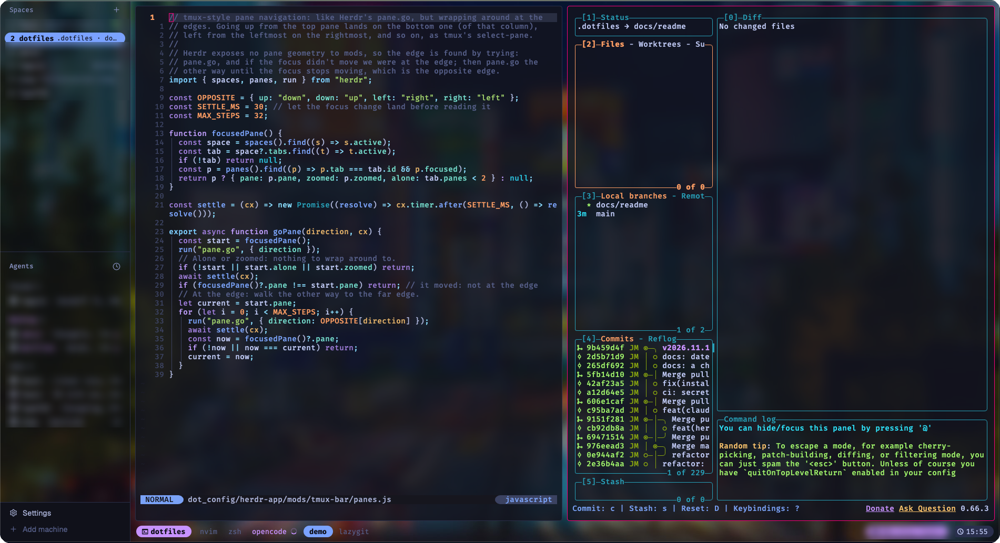
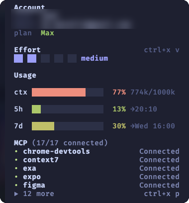

<h1 align="center">dotfiles</h1>

<p align="center">
  A neon Tokyo Night setup for macOS, Arch and Debian/Ubuntu, managed with <a href="https://www.chezmoi.io/">chezmoi</a>.<br>
  zsh · Neovim · tmux · <a href="https://herdr.dev">Herdr</a> · OpenCode · Claude Code
</p>

<p align="center">
  <a href="https://github.com/jmatelli/dotfiles/actions/workflows/checks.yml"></a>
  <a href="https://github.com/jmatelli/dotfiles/releases/latest"></a>
</p>

<p align="center">
  
</p>

<p align="center"><sub>Herdr's <code>neon</code> layout: Neovim and lazygit in one tab, spaces and agents on the left, the tmux-style tab bar at the bottom. Private names are blurred.</sub></p>

<br>

## Contents

- [What's inside](#whats-inside)
- [Install on a new machine](#install-on-a-new-machine)
- [After the install](#after-the-install)
- [Herdr](#herdr)
- [OpenCode and Claude Code](#opencode-and-claude-code)
- [Day to day](#day-to-day)
- [Neovim](#neovim)
- [Secrets](#secrets)
- [Versions and checks](#versions-and-checks)

<br>

## What's inside

| Area | What you get | Where |
| --- | --- | --- |
| **Shell** | zsh with an [oh-my-posh](https://ohmyposh.dev) prompt that fits the pane width, fzf, zoxide, eza, bat, [atuin](https://atuin.sh) history (local only) | `dot_zshrc.tmpl`, `dot_zsh.d/`, `dot_config/oh-my-posh/`, `dot_config/atuin/` |
| **Editor** | Neovim on the native `vim.pack` and native LSP, no distro | `dot_config/nvim/` |
| **Terminal** | Herdr (macOS) with tmux-style keys, a tmux-style bar and rotating backgrounds; tmux on Linux | `dot_config/herdr-app/`, `dot_config/tmux/` |
| **AI agents** | OpenCode with sidebar plugins and reviewer agents; Claude Code with hooks; a work account by folder | `dot_config/opencode/`, `dot_claude/` |
| **Git** | personal and work identities picked by folder, for git and `gh` | `dot_gitconfig*.tmpl`, `dot_local/bin/` |
| **Toolchains** | Node through Volta; Go, Rust, Python, Ruby through [mise](https://mise.jdx.dev/) | `.chezmoiscripts/` |
| **Look** | Tokyo Night, neon variant, everywhere | themes in each tool's folder |

| Platform | Profile |
| --- | --- |
| **macOS** | the daily driver: CLI tools, apps (Homebrew casks), Herdr |
| **Arch / Omarchy** | CLI tools (pacman, a few from the AUR); Omarchy brings its own desktop apps |
| **Debian / Ubuntu** | headless (VPS, Raspberry Pi): CLI tools only |

<br>

## Install on a new machine

Nothing needs to be installed first: a fresh macOS, Arch or Debian/Ubuntu with
a user that can `sudo` is enough. In a terminal (on a Mac: Terminal.app):

```bash
curl -fsSL https://raw.githubusercontent.com/jmatelli/dotfiles/main/install.sh | bash
```

`install.sh` installs Homebrew (macOS, with the Xcode Command Line Tools) or
uses the native package manager, then chezmoi, which clones this repo to
`~/.dotfiles` and applies it: packages and apps, dotfiles, mise, Neovim, Herdr
(macOS) or tmux plugins (Linux). On a Mac this takes a while (100+ packages and apps).

**It asks for:**

| Question | Used for |
| --- | --- |
| Your password | `sudo`; on macOS once, at the start |
| Personal git email | commits outside the projects folder |
| Git name | every commit |
| Work git email | commits under the projects folder |
| Projects folder (default `~/Projects`) | where the work identity applies: git, `gh`, lazygit, Claude Code |

The four questions are stored in `~/.config/chezmoi/chezmoi.toml` and never
asked again on that machine. Some app installs can still ask for the password
or fail on their own: the run keeps going and lists what failed at the end.
Re-running the same command is safe.

<details>
<summary><b>Install a version, a branch or a local checkout instead of <code>main</code></b></summary>

<br>

A known-good version (if `main` is broken, say): any date tag from
[`CHANGELOG.md`](CHANGELOG.md) or the
[releases](https://github.com/jmatelli/dotfiles/releases), the same way as a
branch:

```bash
curl -fsSL https://raw.githubusercontent.com/jmatelli/dotfiles/v2026.11.16/install.sh | DOTFILES_BRANCH=v2026.11.16 bash
```

The checkout in `~/.dotfiles` is then on that tag, not a branch, so
`chezmoi update` can't pull: switch it back with `git -C ~/.dotfiles switch main`
once `main` is fixed.

A branch or a local checkout:

```bash
curl -fsSL https://raw.githubusercontent.com/jmatelli/dotfiles/<branch>/install.sh | DOTFILES_BRANCH=<branch> bash
DOTFILES_REPO=/path/to/checkout DOTFILES_BRANCH=<branch> ./install.sh
```

</details>

<br>

## After the install

These need you (a browser, a password or a key), so the install can't do them.
Open a **new terminal** first, so the shell picks up everything. Each step
stands on its own: do them in any order, or come back to one later.

| | Step | Command |
| :-: | --- | --- |
| 1 | **GitHub**: log in both accounts | `gh auth login` (twice) |
| 2 | **Secrets**: whenever you have the keys | `~/.dotfiles/setup-secrets.sh` |
| 3 | **Claude Code**: personal and work logins | `claude auth login` (twice) |
| 4 | **OpenCode**: providers and MCP sign-ins | `/connect`, `/mcps` |
| 5 | **Herdr** (macOS): this repo's layout | `herdr-app do layout.switch '{"name":"neon"}'` |
| 6 | **Neovim**: plugins and language servers | `nvim` |

### 1. GitHub

Each login opens a browser:

```bash
gh auth login --hostname github.com   # personal: jmatelli
gh auth login --hostname github.com   # work: jomatelli
```

Git then gets the right account's token per folder through `gh` (the `gh`
wrapper and git credential helper in `dot_local/bin/`). A `lazygit` wrapper
does the same, so its branch list shows pull requests for the folder's account;
the account is picked from the folder lazygit starts in.

### 2. Secrets (can wait)

```bash
~/.dotfiles/setup-secrets.sh
```

It asks only for what's missing, and leaving one empty skips it, so you can run
it again later for the rest. They go to `~/.zsh.d/secrets.zsh` (never
committed), which the shell loads when it exists.

| Variable | Used by | Where to get it |
| --- | --- | --- |
| `GITHUB_PERSONAL_ACCESS_TOKEN` | the GitHub MCP server of work repos (yaarz's `.mcp.json`), work account | github.com → Settings → Developer settings → Personal access tokens |
| `GITHUB_PERSONAL_ACCESS_TOKEN_JMATELLI` | the GitHub MCP server of personal repos (heures-app, leguin), personal account | the same, signed in as the personal account |
| `ANTHROPIC_API_KEY` | Claude Code without a logged-in account (optional: step 3 comes first) | console.anthropic.com → API keys |
| `LINEAR_API_KEY` | OpenCode's sidebar (the branch's Linear issue), work workspace | Linear settings → personal API keys |
| `LINEAR_API_KEY_HEURES` | the same, in `~/code/heures-app` (personal Heures workspace) | Linear settings → personal API keys, in Heures |
| `METABASE_MCP_URL` | OpenCode's Metabase MCP server | `https://<metabase instance>/api/metabase-mcp` |

Until a secret is set, only what uses it is missing: OpenCode lists the GitHub
or Metabase MCP server as failed, and its sidebar shows no Linear issue.
Everything else works. After adding secrets, open a new terminal and restart
OpenCode's background service from it, so OpenCode sees them (it keeps the
environment of the terminal that started it):

```bash
opencode service restart
```

### 3. Claude Code

Two accounts, by folder like git: work under the projects folder, personal
everywhere else. Log in once from each kind of folder:

```bash
cd ~ && claude auth login             # personal
cd ~/Projects && claude auth login    # work
```

To use the other account for a while (the work one hit its usage limit, say),
see [switching account](#switching-account).

See [OpenCode and Claude Code](#opencode-and-claude-code) for how it works.

### 4. OpenCode

Run `opencode`, then:

- `/connect` → OpenCode Go (or another provider), to use those models;
- `/mcps` → sign in to each remote MCP server that shows as needing it
  (Figma, Expo…, plus each project's own: Linear, PostHog, Resend, Sentry…,
  signed in from inside that project). GitHub and Metabase use the secrets from
  step 2 instead.

### 5. Herdr (macOS)

Open the Herdr app, then switch it to this repo's layout (it opens on its
default one and remembers the choice afterwards):

```bash
herdr-app do layout.switch '{"name":"neon"}'
```

or press `cmd-shift-l` until the tmux-style bar appears at the bottom.

### 6. Neovim

The first `nvim` installs its plugins and language servers (Mason); give it a
minute, then restart it.

<br>

## Herdr

[Herdr](https://herdr.dev) is the terminal on macOS: spaces, tabs and split
panes like tmux, with agents (OpenCode, Claude Code…) tracked in a sidebar.
This repo gives it a `neon` layout (`dot_config/herdr-app/`):

- a **tmux-style bar**: the space as a pill, tabs by name, a spinner on the
  ones where an agent is working, the host and the clock;
- **Spaces and Agents** lists drawn like the tabs, with each agent's session
  title and state (working, needs you, done);
- **one see-through background** for the whole window, rotating every two hours.

| Keys | Action |
| --- | --- |
| `ctrl-b` `\` / `-` | split right / down |
| `ctrl-b` arrows, `cmd-alt` arrows | move between panes, wrapping around at the edges like tmux |
| `ctrl-b c` / `&` / `,` | new tab / close it / rename it |
| `ctrl-b n` / `p`, `ctrl-b 1`…`9` | next / previous tab, tab by number |
| `ctrl-b h` / `l` | move the tab left / right |
| `ctrl-b z` | zoom the pane |
| `ctrl-b e` / `g` | Files / Changes panel |
| `ctrl-b b` | sidebar |
| `ctrl-b i` | next background |
| `ctrl-b s` | space picker |

All keys are in `dot_config/herdr-app/keys.json`.

After a reboot Herdr brings back spaces, tabs, splits and folders, but each
pane only as a shell. `herdr-panes` (a launchd agent, every 30s) records what
each pane runs and starts it again: nvim, lazygit, OpenCode and Claude Code
(on their session) and a few other tools, never dev servers or builds.
`herdr-panes` alone shows what it would restart; the list is `TOOLS` in
`dot_local/bin/executable_herdr-panes`.

### Backgrounds

<p align="center">
  
</p>

Twelve night photos of Tokyo from [Unsplash](https://unsplash.com), one per
two-hour slot from midnight. `herdr-backgrounds` prepares new ones (cropped to
the window, blurred, darkened, faded behind the tabs) and adds them to the
dotfiles:

```bash
herdr-backgrounds ~/Downloads/*-unsplash.jpg
```

<sub>Photos by Alex Knight, Alexandre Lallemand, Austin Crow, Frank Okay, issa000, Jean Vella, Jezael Melgoza, mos design, Ozgu Ozden and Tom Podmore on Unsplash.</sub>

<br>

## OpenCode and Claude Code



**OpenCode's sidebar** (`dot_config/opencode/plugins/`) shows, for the session:

- the branch's **Linear or GitHub issue**, with a progress bar for its
  sub-issues or checklist, and the parent's;
- the branch's **PR**, its CI and unresolved review threads, and EAS builds;
- the **account and usage** of the selected model's provider, with an
  **effort switch** (click a segment);
- the **MCP servers**, pre-commit checks and waiting sessions.

OpenCode's own tabs are off: each session runs in its own Herdr tab, so Herdr
shows each as its own agent.

**Reviewer agents**: a code-reviewer (Sonnet) for routine changes and a
deep-reviewer (Opus) for risky ones, in both OpenCode and Claude Code.
Next to them, a **security-auditor** (Opus) that can also run gitleaks,
trivy, semgrep, govulncheck, zizmor and the dependency audits, and a
**performance-optimizer** (Sonnet). None of the four can edit files, and
their shell is limited to git diff/log/show, plus the scanners in fixed forms
for the auditor, with plain paths and no extra flags after their fixed
prefix. OpenCode enforces that with each agent's permission rules: no
redirects, quoting or `$`, no git global options (`-c`, `--git-dir`…) or
`GIT_*` variables, and the auditor also has no web or MCP access. Its
shell scanner refuses commands it can't analyze, like zsh's `*(e:…:)`.
Claude Code enforces it with a `PreToolUse` hook in each agent's file,
`~/.claude/hooks/agent-shell-allowlist.sh`. The hook
accepts only plain characters (no quotes, `$`, braces, globs, parentheses,
tabs or redirects), so what it checks is what zsh runs, and it blocks on any
error. Two settings back it up: trivy runs with `--config /dev/null`, so a
`trivy.yaml` in an audited repo is ignored, and git's
`safe.bareRepository = explicit` stops a committed bare repo from running
its own config. The dependency audits still run the repo's yarn and
`.npmrc`; the auditor's prompt says when to skip them. The auditor and
optimizer check the current change by default, or a path or the whole repo
when asked, and report fixes without applying them. Their prompts live in
`.chezmoitemplates/`, shared by both clients.

**Two Claude accounts by folder**: under the projects folder,
`~/.zsh.d/claude-accounts.zsh` points `CLAUDE_CONFIG_DIR` at `~/.claude-work`,
with its own login and history; its settings, agents, hooks and plugins are
links to `~/.claude`. In a work folder `opencode` runs its own server
(`--standalone`), so its Claude Agent models use the work login, and the
sidebar shows that account. Clicking another account in the sidebar's
"Claude 5h" list switches the server to it, starting with the next prompt
(a turn still running on the old account is cut short). An account at its
weekly limit is greyed out and can't be picked. On the shared service, every
window that uses it switches.

**MCP servers by project**: the global `~/.config/opencode/opencode.json` has
only the servers every project uses (browser, docs, search, Expo, Figma…). Services tied to an account live in each project's own config, which
OpenCode merges over the global one: yaarz's `.opencode/opencode.json` (kept
out of its repo by `.git/info/exclude`) adds Linear, Sentry, Stripe, Intercom,
PostHog, Resend and Metabase on the work accounts; heures-app's
`opencode.json` adds Neon, Netlify and `linear-heures`, `posthog-heures`,
`resend-heures` on the personal ones. GitHub too is per repo, with the token of
the account that owns it: yaarz's `.mcp.json` uses the work one, the
`opencode.json` of heures-app, leguin and this repo (ignored by chezmoi, so it
isn't deployed to `~`) the personal one. OpenCode stores an MCP sign-in per server
name, so a service used with two accounts needs two names.

**Worktrees inside the project**: OpenCode creates worktrees in
`<project>/.worktrees/<name>` (`worktree.directory`), ignored by the global
`~/.gitignore`. A worktree of a work repo stays under the projects folder, so
it keeps the work MCP servers, Claude account and git identity.

**Agent skills** (`~/.agents/skills`, installed with `npx skills add -g`) are
tracked through the skills CLI's lockfile, `dot_agents/dot_skill-lock.json`.
On a new machine, `run_onchange_after_45-restore-agent-skills` adds back every
skill in it that's missing, linked to Claude Code and OpenCode. After adding,
updating or removing a skill, run `chezmoi re-add ~/.agents/.skill-lock.json`.

<br clear="right">

### Switching account

`claude-account` (alias `clac`) overrides the folder rule, in the current shell
only:

| Command | Account |
| --- | --- |
| `clac personal` | personal, even in a work folder (e.g. the work one hit its usage limit) |
| `clac work` | work, even outside the projects folder |
| `clac auto` | back to picking by folder |
| `clac` | prints the account in use, e.g. `personal (personal)` |

A running OpenCode keeps its account: quit it, run `clac personal`, then
`opencode -c` to continue the session. The plain `claude` CLI keeps history
per account, so `claude --continue` doesn't see the other account's sessions.

<br>

## Day to day

| Command | What it does |
| --- | --- |
| `chezmoi edit <file>` | edit a dotfile's source (or edit `~/.dotfiles` directly: it's a normal git repo) |
| `chezmoi diff` | preview what would change |
| `chezmoi apply` | sync `$HOME` to the source |
| `chezmoi update` | `git pull` + `apply`, for changes made on another machine |

| To change | Edit |
| --- | --- |
| Packages, per OS | `.chezmoiscripts/run_once_before_10-install-packages.sh.tmpl` |
| Language versions | `.chezmoiscripts/run_once_after_20-setup-mise.sh` |
| The Herdr layout | `dot_config/herdr-app/layouts/modify_neon.json` (Herdr rewrites the file itself when the background changes, so it's a chezmoi `modify_` script) |

> [!NOTE]
> A full `chezmoi apply` re-runs the package script whenever it changed, which
> on macOS means `brew update` and upgrades. Apply single files
> (`chezmoi apply ~/.zshrc`) when that's all you changed.

<br>

## Neovim

`dot_config/nvim` is a minimal, from-scratch config (no distro) on Neovim
≥ 0.12's native `vim.pack` plugin manager and native LSP
(`vim.lsp.config` / `vim.lsp.enable`); the file lists the plugins. Language
servers (`gopls`, `vtsls`, `eslint`…) are installed by Mason from inside
Neovim.

> [!WARNING]
> `vim.pack`'s lockfile, `~/.config/nvim/nvim-pack-lock.json`, is tracked here
> so a new machine gets the same plugin versions. **After
> `:lua vim.pack.update()`, run
> `chezmoi add ~/.config/nvim/nvim-pack-lock.json`** before the next
> `chezmoi apply`, or the apply silently puts the old lockfile, and so the old
> plugins, back.

<br>

## Secrets

Not managed by chezmoi (see [step 2](#2-secrets-can-wait)). Run
`~/.dotfiles/setup-secrets.sh` any time to fill in or add secrets: it checks
what's already set and only asks for what's missing. To add a new one to the
prompts, add a line to `VARS` in the script.

**Tokens inside commands**: keep them in [pass](https://www.passwordstore.org)
and use `secret <entry>` (`~/.zsh.d/secret.zsh`, tab completes entry names)
instead of pasting the value:

```bash
curl -H "Authorization: Bearer $(secret team/yaarz/api-token)" …
STRIPE_API_KEY=$(secret team/yaarz/stripe-test) yarn dev
```

History keeps `$(secret …)`, not the value, so the token stays out of
history, logs and agent transcripts. It doesn't keep agents out: while
gpg-agent has your key unlocked, any process of yours can run `pass show`.
As a safety net, both zsh's history and atuin's skip commands with a literal
token, JWT or password (`secret.zsh` and atuin's `history_filter`, same
patterns).

This repo is public, so a pre-commit hook (`.githooks/pre-commit`) runs
[gitleaks](https://github.com/gitleaks/gitleaks) on the staged changes and
refuses a commit containing a key or token. chezmoi enables it on every clone
(`core.hooksPath`, set by `run_once_after_15-dotfiles-git-hooks.sh`). For a
false positive, allow-list it in `.gitleaks.toml`, or commit once with
`--no-verify`.

<br>

## Versions and checks

**Versions** are date tags (`vYYYY.MM.DD`) on known-good states of `main`, made
at milestones; [`CHANGELOG.md`](CHANGELOG.md) lists what changed in each, and
the latest also has a [release](https://github.com/jmatelli/dotfiles/releases/latest).

**Checks** run on GitHub Actions:

| Workflow | When | What |
| --- | --- | --- |
| `checks` | every PR, every push to `main` | gitleaks over the whole history; every file rendered by chezmoi on Ubuntu and macOS; shellcheck on the scripts |
| `smoke test` | PRs touching the install path, or by hand | `docker-smoke-test.sh`: the install in fresh Ubuntu and Arch containers |

The smoke test also runs locally, against the current checkout (uncommitted
changes included). GUI parts of the Arch install can't run in a container, so
only the CLI install is tested there.

```bash
./docker-smoke-test.sh          # both
./docker-smoke-test.sh ubuntu
./docker-smoke-test.sh arch
```
